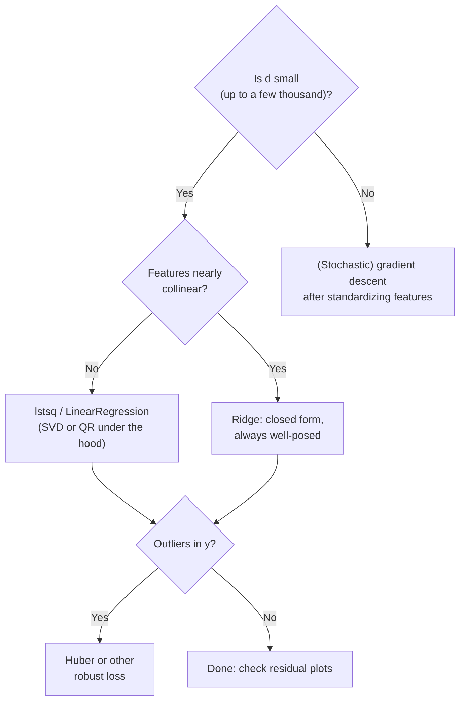

Thirteen people. For each one, a height and a weight. Draw the single straight line that best fits them, and that line predicts the weight of a 155 cm stranger it has never seen to within <span class="txt-highlight">0.94 kg</span>, and a 160 cm stranger to within <span class="txt-highlight">0.26 kg</span>. The whole "model" is two numbers.

Now add a fourteenth person whose record was typed wrong: 150 cm, 90 kg. Refit. The slope of the line drops by <span class="txt-highlight">57%</span>, and the prediction error on those same two strangers grows <span class="txt-highlight">71-fold</span> in mean squared error. One bad row out of fourteen.

Both of those results come from the same algorithm, <span class="txt-main">linear regression</span>, which is probably the oldest and most-used learning method in existence. Least squares was published by Legendre in 1805, and it still runs inside spreadsheets, A/B testing platforms, econometrics papers, and the last layer of many neural networks. It is also the cleanest place to learn ideas that show up everywhere in machine learning: loss functions, gradients, closed-form solutions, conditioning, regularization, and robustness.

In this post I document what I learned about linear regression in my machine learning course, then go further: I derive the math, look at it as pure geometry (a projection in $N$-dimensional space), run every claim as Python code, and dig into the places where a "simple" method behaves in surprising ways. Every number below is real output from scripts you can run yourself.

## 1. The Problem: Predicting a Number

### 1.1 From houses to a formula

Suppose you want to estimate the price $y$ of a house from three measurements: its area $x_1$ in m², its number of bedrooms $x_2$, and its distance to the city centre $x_3$ in km. You have records of 1,000 sold houses. Intuition already gives you the shape of an answer: bigger houses cost more, more bedrooms cost more, and distance lowers the price. The simplest model that captures "each feature pushes the price up or down by a fixed amount per unit" is a weighted sum:

$$\hat{y} = f(\mathbf{x}) = w_1x_1 + w_2x_2 + w_3x_3 + b = \mathbf{w}^\top\mathbf{x} + b$$
 
- $\mathbf{x} = [x_1, x_2, x_3]^\top$ is the **feature vector** (the input).
- $\mathbf{w} = [w_1, w_2, w_3]^\top$ is the **weight vector**, and $b$ is the **bias** or **intercept**. Together they are the **model parameters** we must learn from data.
- $y$ is the **ground truth** (the real price), and $\hat{y}$ is the **prediction**. They will almost never be equal; the goal is to make them close.

Two vocabulary points before going on:
 
- This is a **regression** problem because the output is a continuous number (a price can be any positive real value), as opposed to **classification**, where the output is one of a few labels.
- It is **supervised learning** because every training example comes with its correct answer $y$.

### 1.2 Why "regression"? A detour through 1886

The word has a surprisingly non-mathematical origin. Francis Galton, studying the heights of parents and their adult children in the 1880s, noticed that children of very tall parents tend to be tall, but *less extreme* than their parents, and likewise for very short parents. He called this "regression towards mediocrity" (today: <span class="txt-highlight">regression to the mean</span>). The line he fitted to describe the effect gave the whole family of methods its name. So "regression" originally described a phenomenon in the data, not the fitting technique; the name simply stuck.

### 1.3 Notation used in this post

I stack the $N$ training examples as the rows of a <span class="txt-highlight">design matrix</span>, with a leading column of ones (explained in Section 3.4):
 
$$\bar{X} = \begin{bmatrix} 1 & x_{11} & \cdots & x_{1d} \\ 1 & x_{21} & \cdots & x_{2d} \\ \vdots & \vdots & \ddots & \vdots \\ 1 & x_{N1} & \cdots & x_{Nd} \end{bmatrix} \in \mathbb{R}^{N \times (d+1)}, \qquad \mathbf{y} = \begin{bmatrix} y_1 \\ y_2 \\ \vdots \\ y_N \end{bmatrix} \in \mathbb{R}^{N}$$
 
One row per sample is the convention used by NumPy and scikit-learn. Some books put samples in columns instead; every formula then appears transposed ($XX^\top$ instead of $X^\top X$), but nothing else changes.

## 2. What "Linear" Really Means

### 2.1 Lines, planes, hyperplanes

With one feature, $\hat{y} = w_1x + b$ is a line. With two features, $\hat{y} = w_1x_1 + w_2x_2 + b$ is a plane floating over the $(x_1, x_2)$ floor. With $d > 2$ features we can no longer draw it, but the object is the same: a flat <span class="txt-highlight">hyperplane</span> of dimension $d$ inside $\mathbb{R}^{d+1}$.
 
Strictly speaking, a function with a constant term, $\mathbf{w}^\top\mathbf{x} + b$, is <span class="txt-highlight">affine</span>, not linear: a linear function must satisfy $f(\mathbf{0}) = 0$, and this one gives $b$. Machine learning says "linear" anyway, and the bias trick in Section 3.4 turns the affine model back into a truly linear one in a bigger space, so the sloppiness is harmless.

### 2.2 The important part: linear in the *parameters*

Here is the idea that makes linear regression far more powerful than "fitting straight lines". The algorithm only needs the prediction to be linear in $\mathbf{w}$. The input can go through any fixed transformation first:
 
$$\hat{y} = w_0 + w_1x_1 + w_2x_2 + w_3x_1^2 + w_4\sin(x_2) + w_5x_1x_2$$
 
is curved in $\mathbf{x}$, but it is still a weighted sum of the new features $\phi(\mathbf{x}) = [1, x_1, x_2, x_1^2, \sin x_2, x_1x_2]^\top$, so exactly the same solver applies. Choosing $\phi(x) = [1, x, x^2, \dots, x^p]^\top$ gives **polynomial regression**, which is just linear regression on engineered features.
 
To see this, I generated 60 noisy points from $y = 0.5x^3 - 2x + 2\sin 2x$ and fitted the same least-squares solver with three different feature maps:


_The solver never changes, only the columns of the design matrix._

| Feature map $\phi(x)$  | Train MSE | MSE against the true curve |
| ---------------------- | --------- | -------------------------- |
| $[1, x]$               | 3.54      | 3.44                       |
| $[1, x, x^2, x^3]$     | 1.73      | 1.35                       |
| $[1, x, x^3, \sin 2x]$ | 0.54      | **0.052**                  |

The last model recovered weights $[-0.19, -2.17, 0.53, 2.00]$ against the true $[0, -2, 0.5, 2]$. The catch is obvious: it only works because I *knew* to include $\sin 2x$. In real problems nobody hands you the right features, which is why feature engineering, and, later, neural networks that learn their own features, exist at all.

## 3. Building the Loss and Solving It
 
### 3.1 Measuring one mistake
 
For a single example the error is the <span class="txt-highlight">residual</span> $e = y - \hat{y}$. It can be positive or negative, so we cannot simply minimise it. The standard choice is the squared error:
 
$$\ell(y, \hat{y}) = \frac{1}{2}(y - \hat{y})^2$$
 
The factor $\frac{1}{2}$ is cosmetic: it cancels the 2 that appears when differentiating. Why square rather than take the absolute value $\lvert e \rvert$? Three reasons, in increasing order of depth:
 
1. **Smoothness.** $\lvert e \rvert$ has a kink at $e = 0$ where it has no derivative; $e^2$ is differentiable everywhere, which makes optimisation easy.
2. **A closed-form answer.** The squared loss leads to a linear system (Section 3.3) that can be solved exactly.
3. **Statistics.** Minimising squared error is *exactly* maximum likelihood estimation when the noise is Gaussian (Section 4). The squared loss is not an arbitrary convenience; it encodes an assumption about the noise.

### 3.2 The loss function

Averaging over all $N$ examples gives the **loss function** (also called the **mean squared error** - MSE, up to the $\frac{1}{2}$):
 
$$\mathcal{L}(\mathbf{w}) = \frac{1}{2N}\sum_{i=1}^{N}\left(y_i - \bar{\mathbf{x}}_i^\top\mathbf{w}\right)^2 = \frac{1}{2N}\left\lVert \mathbf{y} - \bar{X}\mathbf{w} \right\rVert_2^2$$
 
and training means solving $\mathbf{w}^* = \arg\min_{\mathbf{w}} \mathcal{L}(\mathbf{w})$.
 
Averaging instead of summing does not change the minimiser, but it makes the number comparable between a training set of 10,000 rows and a test set of 500. Geometrically, the loss is literally an area: each squared residual is a square whose side is the vertical gap between a point and the line, and least squares slides the line until the total orange area is as small as possible.


_The axes use equal aspect, so each square's area really is the residual squared. Left: all 13 training points and the 2 held-out ones. Right: a zoom on the two largest residuals._
 
Notice the squares are measured <span class="txt-highlight">vertically</span>, not perpendicular to the line. Least squares treats $x$ as known exactly and blames all the error on $y$. (Fitting perpendicular distances is a different method, total least squares, closely related to PCA.)

### 3.3 The normal equations
 
$\mathcal{L}$ is a convex quadratic bowl in $\mathbf{w}$, so its minimum is where the gradient vanishes. The gradient is:
 
$$\nabla_{\mathbf{w}}\mathcal{L}(\mathbf{w}) = \frac{1}{N}\bar{X}^\top\left(\bar{X}\mathbf{w} - \mathbf{y}\right)$$
 
Setting it to zero gives the <span class="txt-highlight">normal equations</span>:
 
$$\bar{X}^\top\bar{X}\,\mathbf{w} = \bar{X}^\top\mathbf{y}$$
 
If the $(d+1) \times (d+1)$ matrix $\bar{X}^\top\bar{X}$ is invertible (which happens exactly when the columns of $\bar{X}$ are linearly independent), the solution is unique:
 
$$\mathbf{w}^* = \left(\bar{X}^\top\bar{X}\right)^{-1}\bar{X}^\top\mathbf{y}$$
 
### 3.4 The bias trick
 
Carrying a separate $b$ through every formula is tedious. Instead, append a constant feature $x_0 = 1$ to every input and absorb $b$ into the weights:
 
$$\mathbf{w}^\top\mathbf{x} + b = \underbrace{[1, x_1, \dots, x_d]}_{\bar{\mathbf{x}}^\top}\underbrace{[b, w_1, \dots, w_d]^\top}_{\bar{\mathbf{w}}}$$
 
Note the dimensions: $\bar{\mathbf{x}}$ and $\bar{\mathbf{w}}$ have $d + 1$ entries (one per feature plus one), not $N + 1$; $N$ counts samples, $d$ counts features, and mixing them up is a common slip when writing this out by hand. That column of ones is why $\bar{X}$ in Section 1.3 starts with ones. The trick also turns the affine model into a truly linear one in $\mathbb{R}^{d+1}$, and you will meet it again in logistic regression, SVMs and neural networks.
 
### 3.5 When $\bar{X}^\top\bar{X}$ is singular
 
If two features are perfectly redundant (height in centimetres *and* height in metres, say), the columns of $\bar{X}$ are linearly dependent and $\bar{X}^\top\bar{X}$ has no inverse. A claim you may come across is that the normal equations then have "either no solution or infinitely many". Only the second half can happen. The right-hand side $\bar{X}^\top\mathbf{y}$ always lies in the column space of $\bar{X}^\top$, which is the same subspace as the column space of $\bar{X}^\top\bar{X}$, so the system is <span class="txt-highlight">always consistent</span>. Least squares always has a minimiser; singularity only means there are infinitely many of them, all giving identical predictions.
 
Among those infinitely many, one is special: the one with the smallest norm $\lVert\mathbf{w}\rVert_2$. It is given by the <span class="txt-name">Moore–Penrose pseudo-inverse</span>, which exists for every matrix, square or not:
 
$$\mathbf{w}^\dagger = \bar{X}^\dagger\mathbf{y} = \left(\bar{X}^\top\bar{X}\right)^\dagger\bar{X}^\top\mathbf{y}$$
 
I tested this directly with the height data, giving the model both height in cm and height in m:
 
```text
rank(X^T X) = 2 of 3
det(X^T X)  = -1.512e-10   (should be exactly 0; floating point says otherwise)
  pinv       w = [-33.73541   0.559149  0.005591]  train MSE = 0.218354
  all on cm  w = [-33.73541   0.559205  0.      ]  train MSE = 0.218354
  all on m   w = [-33.73541   0.        55.920496]  train MSE = 0.218354
```
 
Three different weight vectors, identical training error, all satisfying the normal equations to within $10^{-10}$. The pseudo-inverse splits the slope between the two columns in a 100 : 1 ratio, matching their scales, because that is the split with the smallest norm. And notice the determinant: mathematically exactly zero, numerically $-1.5 \times 10^{-10}$. Never test invertibility with `det`; use the rank or the condition number.
 
### 3.6 The geometry: least squares is a projection
 
This is my favourite way to see linear regression, and it makes the formulas above almost obvious. Stop thinking of each data point as a dot in a scatter plot. Instead, think of the whole target vector $\mathbf{y}$ as a *single point* in $\mathbb{R}^N$, with one axis per training example.
 
Every possible prediction $\hat{\mathbf{y}} = \bar{X}\mathbf{w}$ is a linear combination of the columns of $\bar{X}$, so the set of all achievable predictions is the <span class="txt-highlight">column space</span> $\text{span}(\bar{X})$, a flat subspace of dimension $d + 1$. Minimising $\lVert\mathbf{y} - \bar{X}\mathbf{w}\rVert$ asks for the point of that subspace closest to $\mathbf{y}$, and the closest point is the <span class="txt-highlight">orthogonal projection</span>. The residual must therefore be perpendicular to every column:
 
$$\bar{X}^\top\left(\mathbf{y} - \bar{X}\mathbf{w}\right) = \mathbf{0}$$
 
which is the normal equations again, derived without a single derivative. With three data points, $\mathbf{y}$ lives in 3-D and the picture can actually be drawn:


_Three samples with $x = [1, 2, 3]$ and $y = [3, 0, 3]$. The plane is spanned by the column of ones and the column $x$. The best fit is the flat line $\hat{y} = 2$, and the residual $[1, -2, 1]$ is perpendicular to both columns._
 
Two practical facts fall straight out of this picture, and I checked both on the height data:
 
- **With an intercept, residuals sum to zero.** The column of ones is one of the columns, so $\mathbf{1}^\top\mathbf{e} = 0$. Measured: $7.1 \times 10^{-14}$.
- **Residuals are uncorrelated with every feature.** Measured $\sum_i e_i x_i = 1.2 \times 10^{-11}$. If you plot residuals against a feature and see a *trend*, the fit is wrong; if you see a *curve*, the model is missing a nonlinear feature.

The projection matrix $P = \bar{X}(\bar{X}^\top\bar{X})^{-1}\bar{X}^\top$ that maps $\mathbf{y}$ to $\hat{\mathbf{y}}$ is often called the **hat matrix**, because it "puts the hat on y".
 
## 4. The Probabilistic View: Why Squares, Really
 
Assume the data come from a linear model plus independent Gaussian noise:
 
$$y_i = \bar{\mathbf{x}}_i^\top\mathbf{w} + \varepsilon_i, \qquad \varepsilon_i \sim \mathcal{N}(0, \sigma^2)$$
 
The likelihood of the observed targets is a product of Gaussians, and its negative logarithm is:
 
$$-\log p(\mathbf{y} \mid \bar{X}, \mathbf{w}) = \frac{N}{2}\log(2\pi\sigma^2) + \frac{1}{2\sigma^2}\sum_{i=1}^{N}\left(y_i - \bar{\mathbf{x}}_i^\top\mathbf{w}\right)^2$$
 
The first term does not depend on $\mathbf{w}$, so **maximising the likelihood is the same as minimising the sum of squared residuals**. Least squares is maximum likelihood under Gaussian noise.
 
A second, assumption-lighter result is the <span class="txt-name">Gauss–Markov theorem</span>: if the errors have zero mean, equal variance and are uncorrelated (no normality needed), the least-squares estimator has the smallest variance among all *linear unbiased* estimators. It is "BLUE": the Best Linear Unbiased Estimator.
 
This framing matters for the limitations in Section 7. Least squares is not bad at handling noise; for Gaussian-like noise it is provably the best you can do. What it handles badly are **outliers**, points that violate the noise model. A Gaussian assigns almost zero probability to a 30 kg miss, so the fit bends dramatically to explain it.
 
## 5. Linear Regression Compared With Its Neighbours
 
Placing linear regression next to related methods helped me pin down what it actually is:
 
| Method                    | Output                 | Model                                                                   | Loss                                                                                     | Solved by                                       |
| ------------------------- | ---------------------- | ----------------------------------------------------------------------- | ---------------------------------------------------------------------------------------- | ----------------------------------------------- |
| **Linear regression**     | real number            | $\mathbf{w}^\top\mathbf{x} + b$                                         | squared error                                                                            | closed form or gradient descent                 |
| Polynomial regression     | real number            | $\mathbf{w}^\top\phi(\mathbf{x})$, $\phi$ = powers of $x$               | squared error                                                                            | same as linear regression                       |
| Ridge / LASSO             | real number            | $\mathbf{w}^\top\mathbf{x} + b$                                         | squared error + $\lambda\lVert\mathbf{w}\rVert_2^2$ or $\lambda\lVert\mathbf{w}\rVert_1$ | closed form (ridge), coordinate descent (LASSO) |
| Huber regression          | real number            | $\mathbf{w}^\top\mathbf{x} + b$                                         | squared near 0, absolute far away                                                        | iterative (L-BFGS)                              |
| Logistic regression       | probability of a class | $\sigma(\mathbf{w}^\top\mathbf{x} + b)$                                 | cross-entropy                                                                            | iterative only                                  |
| k-NN regression           | real number            | average of nearest neighbours' targets                                  | none (no training)                                                                       | stores the data                                 |
| Neural network regression | real number            | $\mathbf{w}^\top h_\theta(\mathbf{x}) + b$, learned features $h_\theta$ | usually squared error                                                                    | gradient descent                                |
 
Three observations from this table:
 
- **Despite its name, logistic regression is a classifier.** It reuses the linear score $\mathbf{w}^\top\mathbf{x}$ but squashes it into $(0, 1)$, and the resulting loss has no closed-form minimiser.
- **Linear regression is parametric; k-NN is not.** Linear regression compresses the training set into $d + 1$ numbers and can then throw the data away; k-NN keeps everything and can fit any shape, at the cost of memory and the scaling sensitivity I measured in the feature engineering post.
- **A neural network for regression ends in a linear regression.** The last layer is literally $\mathbf{w}^\top h + b$ with a squared loss; everything before it learns the feature map $h_\theta$ that, in Section 2.2, I had to invent by hand.

## 6. Hands-On Demo: Height Predicts Weight

### 6.1 The data

Fifteen people, height in cm and weight in kg. The 155 cm and 160 cm records are held out as a test set; the other 13 are for training.

| Height (cm) | 147 | 150 | 153 | 158 | 163 | 165 | 168 | 170 | 173 | 175 | 178 | 180 | 183 |
| ----------- | --- | --- | --- | --- | --- | --- | --- | --- | --- | --- | --- | --- | --- |
| Weight (kg) | 49  | 50  | 51  | 54  | 58  | 59  | 60  | 62  | 63  | 64  | 66  | 67  | 68  |

Test set: (155 cm, 52 kg) and (160 cm, 56 kg). Of course, weight depends on far more than height, so this is a toy problem, but the near-linear trend makes it a good first fit.

### 6.2 Four ways to get the same line

**(a) From scratch, with plain loops.** With a single feature, the normal equations reduce to a famous pair of formulas: the slope is the covariance of $x$ and $y$ divided by the variance of $x$, and the line passes through the point of means:
 
$$w_1 = \frac{\sum_i (x_i - \bar{x})(y_i - \bar{y})}{\sum_i (x_i - \bar{x})^2}, \qquad w_0 = \bar{y} - w_1\bar{x}$$

```python
height = [147, 150, 153, 158, 163, 165, 168, 170, 173, 175, 178, 180, 183]
weight = [ 49,  50,  51,  54,  58,  59,  60,  62,  63,  64,  66,  67,  68]

n = len(height)
mx = sum(height) / n
my = sum(weight) / n
sxy = sum((height[i] - mx) * (weight[i] - my) for i in range(n))   # n * covariance
sxx = sum((height[i] - mx) ** 2 for i in range(n))                 # n * variance

w1 = sxy / sxx
w0 = my - w1 * mx

print(f"w1 = {w1:.8f}  w0 = {w0:.8f}")
```

**(b) The normal equations, (c) the pseudo-inverse and `lstsq`, (d) scikit-learn:**
```python
import numpy as np
from sklearn.linear_model import LinearRegression

height = np.array(height, dtype = float)
weight = np.array(weight, dtype = float)
Xbar = np.column_stack([np.ones(len(height)), height])      # bias trick: column of ones

w_ne    = np.linalg.solve(Xbar.T @ Xbar, Xbar.T @ weight)   # (b) solve, never inv()
w_pinv  = np.linalg.pinv(Xbar) @ weight                     # (c) pseudo-inverse of X
w_lstsq = np.linear.lstsq(Xbar, weight, rcond = None)[0]    # (c) SVD-based least squares


reg = LinearRegression().fit(height.reshape(-1, 1), weight) # (d) one row per sample
```

Output:

```text
(a) loops          : w1 = 0.55920496  w0 = -33.73541021
(b) normal eq.     : w1 = 0.55920496  w0 = -33.73541021
(c) pinv           : w1 = 0.55920496  w0 = -33.73541021
    lstsq          : w1 = 0.55920496  w0 = -33.73541021
(d) scikit-learn   : w1 = 0.55920496  w0 = -33.73541021
```

All four agree to every printed digit. The model says: <span class="txt-highlight">each extra centimetre of height adds about 0.56 kg</span>, and the line is $\hat{y} = 0.5592x - 33.74$. Under the hood, `LinearRegression` on dense data is a thin wrapper around `scipy.linalg.lstsq`, i.e. option (c).
 
Three implementation habits worth stating explicitly:
 
- **Use `solve`, never `inv`.** Computing an explicit inverse is slower and less accurate than solving the system directly.
- **Prefer `lstsq(X, y)` or `pinv(X)` over anything built from `X.T @ X`.** Forming $\bar{X}^\top\bar{X}$ *squares* the condition number of the problem (Section 8.1 measures it: $2.5 \times 10^3$ becomes $6.1 \times 10^6$), so `pinv(Xbar.T @ Xbar) @ Xbar.T @ y` loses about twice as many significant digits as working on $\bar{X}$ directly. Here the data are tiny and well behaved, so all routes agree; on wide or nearly collinear data they will not.
- **Mind the shapes.** scikit-learn wants `X` as a 2-D array of shape `(n_samples, n_features)`, which is why the single feature needs `reshape(-1, 1)`.

### 6.3 Evaluating the fit

```text
train MSE  : 0.2184   RMSE = 0.4673 kg
train R^2  : 0.9945
test  155 cm: true 52 kg, predicted 52.94 kg, error +0.94 kg
test  160 cm: true 56 kg, predicted 55.74 kg, error -0.26 kg
largest train residual: -0.823 kg at 153 cm
```
 
The **coefficient of determination** compares the model's squared error with that of the dumbest possible model, one that always predicts the mean $\bar{y}$:
 
$$R^2 = 1 - \frac{\sum_i (y_i - \hat{y}_i)^2}{\sum_i (y_i - \bar{y})^2}$$
 
$R^2 = 0.9945$ says the line accounts for 99.45% of the training variance in weight. Two warnings that I find people (including me, initially) get wrong:
 
- **$R^2$ is not bounded below by 0.** On training data with an intercept it lies in $[0, 1]$, but on *test* data a model worse than the mean gets a negative score. In Section 9 the "always predict the training mean" baseline scores $R^2 = -0.014$ on the test set, because the test mean differs slightly from the training mean.
- **A high $R^2$ does not mean the model is right.** The four datasets below, constructed by Anscombe in 1973, have the same fitted line ($\hat{y} = 3.00 + 0.50x$) and the same $R^2 = 0.67$ to two decimals, which I verified:


_I: a reasonable linear fit. II: a curve, so a line is the wrong model. III: a perfect line ruined by one outlier. IV: the slope is decided by a single point._
 
The only defence is to **plot the data and the residuals**. A score summarises; it does not diagnose.
 
## 7. Where the Straight Line Breaks
 
### 7.1 Outliers: one bad record
 
Back to the opening experiment: add one corrupted record, (150 cm, 90 kg), to the 13 clean ones.
 

_The dotted line is the clean fit. Ordinary least squares (orange) rotates toward the outlier; Huber regression (blue) barely moves._
 
| Model             | Slope  | Intercept | Pred. 155 cm | Pred. 160 cm | Test MSE   |
| ----------------- | ------ | --------- | ------------ | ------------ | ---------- |
| OLS, clean data   | 0.5592 | −33.735   | 52.94        | 55.74        | 0.478      |
| OLS + outlier     | 0.2378 | +22.219   | 59.07        | 60.26        | **34.078** |
| Huber, clean data | 0.5554 | −33.061   | 53.02        | 55.80        | 0.543      |
| Huber + outlier   | 0.5477 | −31.731   | 53.17        | 55.91        | **0.688**  |
 
Why so fragile? A residual of 30 kg contributes $30^2 = 900$ to the loss, as much as **thousands** of residuals of half a kilogram. The squared loss is so afraid of large errors that it sacrifices all the other points to shrink the one.
 
*Where* the outlier sits matters too. The same 90 kg reading placed at different heights:
 
| Outlier at                                        | Slope  | Intercept |
| ------------------------------------------------- | ------ | --------- |
| 150 cm (near the left edge)                       | 0.2378 | +22.219   |
| 165 cm (near the middle, $\bar{x} \approx 166.4$) | 0.5345 | −27.383   |
| 183 cm (right edge)                               | 0.7336 | −61.429   |
 
An outlier near the centre of the $x$-range mostly lifts the line; one at the edge acts like a lever arm and rotates it. Statisticians call this **leverage**: points with extreme $x$ values have more power over the fit. (Formally, the leverage of point $i$ is the diagonal entry $P_{ii}$ of the hat matrix from Section 3.6.)
 
**The fix: change the loss.** The **Huber loss**, introduced by Peter Huber in 1964, is quadratic for small residuals and linear for large ones:
 
$$\ell_\delta(r) = \begin{cases} \frac{1}{2}r^2 & \text{if } \lvert r \rvert \le \delta \\ \delta\lvert r \rvert - \frac{1}{2}\delta^2 & \text{otherwise} \end{cases}$$
 

_Squared loss grows without mercy; absolute loss treats every unit of error equally; Huber behaves like squared loss near zero and like absolute loss in the tails._
 
Two details of scikit-learn's `HuberRegressor` that tripped me up:
 
- The threshold `epsilon` (default 1.35) applies to the residual **divided by a scale $\sigma$** that the model estimates jointly with the weights, so it adapts to the units of $y$. I set `alpha=0.0` to switch off its default small L2 penalty and compare pure losses.
- Its `outliers_` attribute flagged **four** points here: the corrupted one and also 153, 158 and 170 cm. That looks alarming but isn't: the estimated scale is tiny (the clean residuals are around half a kilogram), so any point beyond $1.35\sigma$ simply gets the linear branch of the loss. Points are down-weighted, never discarded.
```python
from sklearn.linear_model import HuberRegressor
 
huber = HuberRegressor(epsilon=1.35, alpha=0.0, max_iter=10_000).fit(H_out.reshape(-1, 1), W_out)
print(huber.coef_, huber.intercept_, huber.outliers_)
```
 
### 7.2 Extrapolation: a line has no idea where its data ended
 
The fitted line hits zero weight at $33.735 / 0.5592 = 60.33$ cm. A newborn measuring 50 cm is predicted to weigh **−5.78 kg**.


_Inside the shaded training range (147 to 183 cm) the line is excellent. Outside it, the model keeps its constant slope forever._
 
The intercept $w_0 = -33.74$ has no physical meaning; it is the value of the line at a height of 0 cm, 147 cm away from any data. Linear regression is a *local* approximation that is reliable only near the data it saw. Interpreting the intercept literally is one of the most common misreadings of a regression output.
 
### 7.3 A line cannot bend
 
If the true relationship curves (panel II of Anscombe's quartet), a straight line will be systematically wrong in a predictable pattern, and the residual plot will show a curve. The fix is the one from Section 2.2: add nonlinear features, or move to a model that learns them. The usual trade-off follows immediately: more features means more capacity, and more capacity means overfitting risk.
 
### 7.4 Correlated features: weights that can't be trusted
 
Section 3.5 had *perfectly* collinear features. The more common and sneakier case is *nearly* collinear ones. On scikit-learn's diabetes dataset (442 patients, 10 features), the blood-serum measurements `s1` and `s2` have a correlation of $r = 0.893$ on the training split. OLS responds by giving them large weights of opposite sign that mostly cancel:
 

_OLS assigns −918.5 to `s1` and +508.3 to `s2`. Ridge with α = 0.1 shrinks them to −118.1 and −80.9, and the test score slightly improves._
 
When features are nearly collinear, many very different weight vectors fit the data almost equally well, so the specific values OLS picks are dominated by noise. The predictions can still be fine, but **reading the coefficients as "importance" becomes meaningless**. That is precisely the situation ridge regression was invented for.
 
## 8. Solving It at Scale
 
### 8.1 Gradient descent and the shape of the bowl
 
The closed form needs to build and solve a $(d+1) \times (d+1)$ system. The alternative is **gradient descent**: start somewhere, repeatedly step downhill,
 
$$\mathbf{w} \leftarrow \mathbf{w} - \eta\,\nabla\mathcal{L}(\mathbf{w}) = \mathbf{w} - \frac{\eta}{N}\bar{X}^\top\left(\bar{X}\mathbf{w} - \mathbf{y}\right)$$
 
which costs only $O(Nd)$ per step and never inverts anything. On a quadratic loss the convergence speed is governed by the eigenvalues $\mu_{\min} \le \dots \le \mu_{\max}$ of the Hessian $\frac{1}{N}\bar{X}^\top\bar{X}$. With the safe step $\eta = 1/\mu_{\max}$, the error along the slowest direction shrinks by a factor $(1 - \mu_{\min}/\mu_{\max})$ per step, so the number of steps scales with the **condition number** $\kappa = \mu_{\max}/\mu_{\min}$.
 
And here is where the "simple" height data gave me the most surprising result of this post. Heights near 165 cm next to a column of ones make the two columns of $\bar{X}$ point in almost the same direction:
 
```text
cond(X^T X), raw cm       :    6141863.0
cond(X^T X), centered     :        125.9
cond(X^T X), standardized :          1.0
Hessian eigenvalues (raw cm): [0.004528  27810.764703]  ->  kappa = 6.142e+06
```
 
So I ran plain gradient descent on raw heights for ten million iterations:
 
```text
raw GD after         10 its: w1 = 0.357355  w0 =    0.0021  loss - optimum = 2.5771e+00
raw GD after      1,000 its: w1 = 0.357388  w0 =   -0.0034  loss - optimum = 2.5762e+00
raw GD after    100,000 its: w1 = 0.360615  w0 =   -0.5427  loss - optimum = 2.4945e+00
raw GD after 10,000,000 its: w1 = 0.519584  w0 =  -27.1131  loss - optimum = 9.9292e-02
```
 
After **ten million** steps on a problem with 13 points and 2 parameters, gradient descent still has the intercept wrong by 6.6 kg. The theory predicts about $8.5 \times 10^7$ iterations just to shrink the slow error by a factor of a million. With **standardized** heights ($z = (x - \bar{x})/s$), the same algorithm converges in exactly **one** step:
 

_Left: in raw units the loss is a valley about a million times longer than it is wide. The first step finds the slope direction; then the iterates crawl along the valley floor. Right: after standardizing, the contours are circles._


_Raw: about $10^8$ iterations. Centered: a few thousand. Standardized: one. Generated by `figures.py`._
 
Why exactly one step? After standardizing with the population standard deviation, the column of ones and the column $z$ are orthogonal and both have mean square 1, so the Hessian $\frac{1}{N}\bar{X}^\top\bar{X}$ is the identity matrix. With $\eta = 1$, one gradient step lands exactly on the minimiser: it is Newton's method in disguise. Mapping the result back to centimetres gives $w_1 = 0.55920496$, $w_0 = -33.73541021$, the same as every other method.
 
This is the real reason feature scaling matters for gradient-based training, and it applies to every model trained this way, not just linear regression.
 
### 8.2 Choosing a solver
 
On one CPU-only machine (absolute times will differ on yours, the trend will not):
 
| Problem size                  | Normal equations | `lstsq` (SVD) | One GD step |
| ----------------------------- | ---------------- | ------------- | ----------- |
| $N = 400$, $d = 100$          | 1.2 ms           | 4.8 ms        | 0.07 ms     |
| $N = 4{,}000$, $d = 1{,}000$  | 58 ms            | 464 ms        | 15 ms       |
| $N = 12{,}000$, $d = 3{,}000$ | 1.21 s           | 7.97 s        | 0.099 s     |
 
The normal equations cost $O(Nd^2 + d^3)$, SVD is more expensive but numerically the safest, and a gradient step is $O(Nd)$. When $N$ or $d$ reaches the millions, or data arrive as a stream, **stochastic gradient descent** on mini-batches is the only option, which is how linear models are trained at web scale (e.g. scikit-learn's `SGDRegressor`).
 

 
## 9. Ridge Regression: Making the Problem Well-Posed
 
<span class="txt-name">Ridge regression</span> adds a penalty on the size of the weights:
 
$$\mathcal{L}_{\text{ridge}}(\mathbf{w}) = \frac{1}{2N}\left(\lVert\mathbf{y} - \bar{X}\mathbf{w}\rVert_2^2 + \lambda\lVert\mathbf{w}\rVert_2^2\right), \qquad \lambda > 0$$
 
Setting the gradient to zero gives:
 
$$\left(\bar{X}^\top\bar{X} + \lambda I\right)\mathbf{w} = \bar{X}^\top\mathbf{y}$$
 
The new matrix is always invertible, for a one-line reason: it is **positive definite**. For any $\mathbf{w} \ne \mathbf{0}$,
 
$$\mathbf{w}^\top\left(\bar{X}^\top\bar{X} + \lambda I\right)\mathbf{w} = \lVert\bar{X}\mathbf{w}\rVert_2^2 + \lambda\lVert\mathbf{w}\rVert_2^2 > 0$$
 
so it has no zero eigenvalue. Adding $\lambda I$ lifts every eigenvalue by $\lambda$, which also caps the condition number at $(\mu_{\max} + \lambda)/(\mu_{\min} + \lambda)$. In practice the intercept is left out of the penalty (it just encodes the average level of $y$), which scikit-learn's `Ridge` does automatically.
 
Three things I verified in code:
 
- **As $\lambda \to 0$, ridge converges to the pseudo-inverse solution.** On the collinear cm-and-m data, ridge with $\lambda = 10^{-6}$ returned $[-33.73541, 0.559149, 0.005592]$, matching the minimum-norm solution from Section 3.5.
- **$\lambda$ does not have to be "very small".** Its useful range depends on how the loss is normalised and on the scale of the features. The diabetes features in scikit-learn are pre-scaled so each column has unit Euclidean norm, which makes the data tiny, so even $\alpha = 1$ already over-shrinks:

| Model on diabetes (25% test split, seed 42) | Test $R^2$ | Test RMSE |
| ------------------------------------------- | ---------- | --------- |
| Always predict the training mean            | −0.014     | 74.88     |
| OLS, 10 features                            | 0.4849     | 53.37     |
| Ridge, $\alpha = 0.01$                      | 0.4871     | —         |
| Ridge, $\alpha = 0.1$                       | **0.4918** | —         |
| Ridge, $\alpha = 1$                         | 0.4384     | —         |
 
  Treat $\lambda$ as a hyperparameter and tune it on a log grid with cross-validation.
- **Ridge stabilises coefficients more than it changes predictions.** The $R^2$ gain above is small, but the `s1`/`s2` weights went from −918/+508 to −118/−81 (Section 7.4).
Ridge also has a Bayesian reading that completes Section 4: it is the **maximum a posteriori** estimate when the weights get a Gaussian prior $\mathbf{w} \sim \mathcal{N}(\mathbf{0}, \tau^2 I)$, with $\lambda = \sigma^2/\tau^2$. Replacing the squared norm with $\lVert\mathbf{w}\rVert_1$ gives LASSO, which sets some weights exactly to zero; I compared the two geometrically in the overfitting post.
 
## 10. Where Linear Regression Shows Up in AI Systems
 
| Area                         | How linear regression is used                                                                                                                               |
| ---------------------------- | ----------------------------------------------------------------------------------------------------------------------------------------------------------- |
| **Baselines**                | the first model to fit on any tabular regression task; if a deep model can't beat it, something is wrong                                                    |
| **Time-series forecasting**  | autoregressive (AR) models are linear regressions on lagged values $y_{t-1}, y_{t-2}, \dots$                                                                |
| **Deep learning**            | the output layer of a regression network is $\mathbf{w}^\top h + b$ trained with squared error                                                              |
| **Probing representations**  | "linear probes" fit a linear model on frozen hidden activations to test what information a layer encodes                                                    |
| **Explainability**           | LIME (Ribeiro et al., 2016) explains a black-box prediction by fitting a local weighted linear model around it                                              |
| **Scaling laws for LLMs**    | a power law $L = aN^{-\alpha}$ becomes a straight line in log-log space, $\log L = \log a - \alpha\log N$, so its exponent can be estimated by a linear fit |
| **A/B testing**              | variance-reduction techniques such as CUPED (Deng et al., 2013) regress the experiment metric on pre-experiment data to remove predictable variance         |
| **Econometrics and science** | coefficients with confidence intervals quantify effects, as long as the assumptions of Section 4 are checked                                                |
 
The common thread: linear regression survives not because it is the most accurate model, but because it is **fast, stable, and interpretable**, and because a linear model on top of good features (engineered by hand or learned by a network) is often all you need.
 

